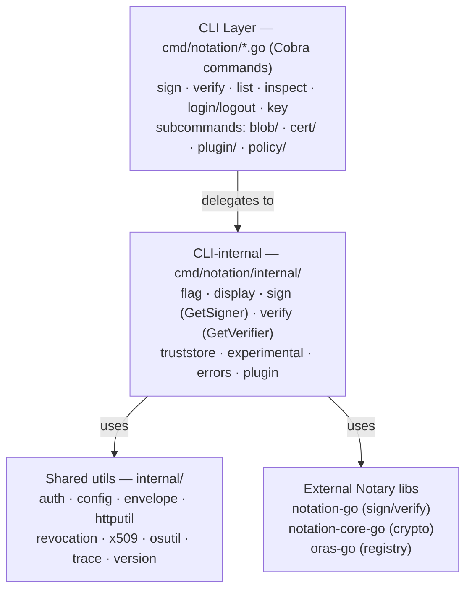
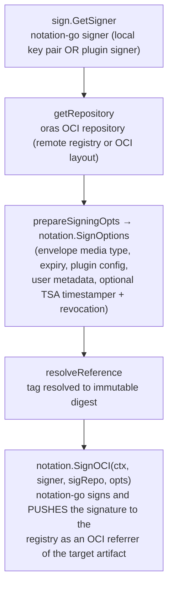
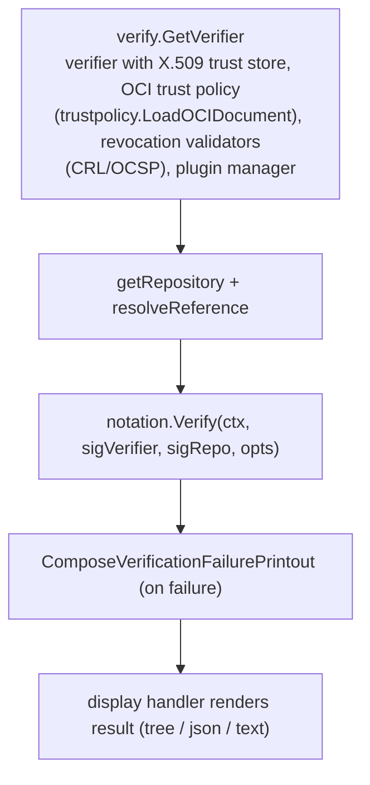
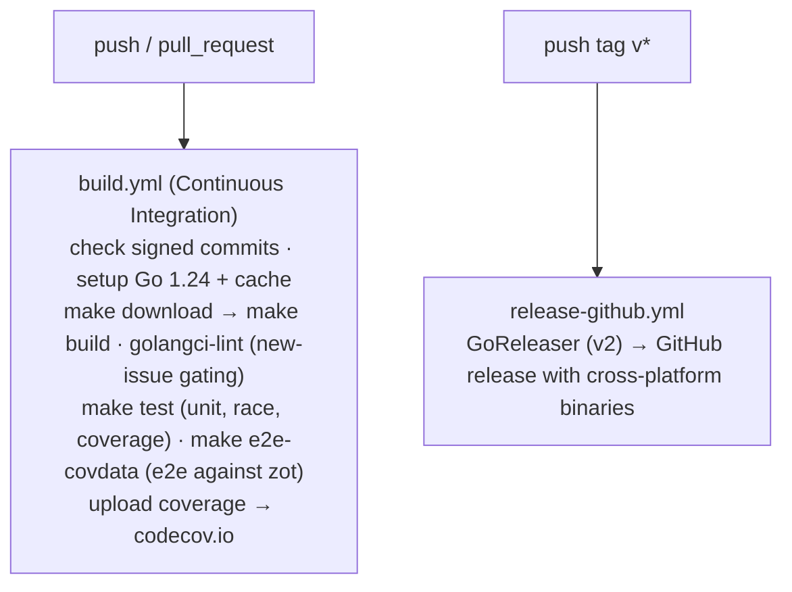

# Notation Architecture

Notation is the [Notary Project](https://notaryproject.dev) CLI for signing and verifying artifacts in the OCI registry ecosystem. It stores signatures as OCI **referrers** alongside the artifact they sign — conceptually similar to git commit signing, but generic and usable for arbitrary security purposes.

- **Module:** `github.com/notaryproject/notation/v2` (Go `>= 1.24`)
- **Entry point:** [`cmd/notation/main.go`](cmd/notation/main.go) → `run()` assembles the root Cobra command and registers all subcommands
- **Core frameworks:** [Cobra](https://github.com/spf13/cobra) (CLI), [`oras-go/v2`](https://oras.land) (OCI registry & OCI-layout I/O)
- **Notary libraries** (where the real work happens):
  - `notation-go` — sign / verify / list algorithms, trust policy, plugin manager
  - `notation-core-go` — signature envelopes, X.509, revocation (CRL/OCSP)
  - `notation-plugin-framework-go` — plugin contract
  - `tspclient-go` — RFC 3161 timestamping

For package- and symbol-level detail, see the Go documentation (`go doc ./...` or [pkg.go.dev](https://pkg.go.dev/github.com/notaryproject/notation/v2)); this document intentionally stays at the architectural level so it does not drift from the code.

## Table of Contents

- [Design Philosophy](#design-philosophy)
- [High-Level Architecture](#high-level-architecture)
- [Core Workflows](#core-workflows)
- [Trust Model](#trust-model)
- [Developer Workflow](#developer-workflow)
- [User-Facing CLI Workflows](#user-facing-cli-workflows)

## Design Philosophy

1. **Thin CLI layer.** Command files in `cmd/notation/` only parse flags and orchestrate. All cryptographic algorithms live in `notation-go` / `notation-core-go`. This keeps the CLI auditable and lets the libraries be reused by other tools.
2. **Centralized registry plumbing.** All OCI registry, auth, and OCI-layout access flows through [`registry.go`](cmd/notation/registry.go) (`getRepository`), so transport, credentials, and referrers-fallback logic live in one place.
3. **Two `internal/` trees, two concerns.**
   - `cmd/notation/internal/` — CLI *presentation* concerns (flags, output rendering, signer/verifier construction, experimental gating).
   - `internal/` — reusable *lower-level* utilities (auth store, config cache, HTTP client, revocation, x509, version).
4. **Pluggable everything.** Signing keys, verification, and revocation are all pluggable via the plugin framework and JSON trust policies.

## High-Level Architecture



The package layout under these trees is documented in the Go source itself; run `go doc ./cmd/notation/...` or `go doc ./internal/...` for the authoritative, always-current listing.

## Core Workflows

### Signing (`runSign`, `cmd/notation/sign.go`)



### Verification (`runVerify`, `cmd/notation/verify.go`)



Blob commands mirror these flows using `notation.BlobSigner` / `BlobVerifier`.

## Trust Model

Verification is governed by three on-disk artifacts, all under the Notation config directory (overridable with `NOTATION_CONFIG`):

1. **Trust store** — X.509 CA/certificate roots under `truststore/x509/<type>/<store>/`, managed by `notation cert`.
2. **Trust policy** — a JSON document (`trustpolicy.oci.json` / `trustpolicy.blob.json`) mapping registry scopes to trust stores, signature verification levels, and trusted identities; managed by `notation policy` / `notation blob policy`.
3. **Signing keys** — the key list in `config.json`, managed by `notation key`.

Revocation (CRL/OCSP) and RFC 3161 timestamping are layered on top during both signing and verification.

## Developer Workflow

Build tooling is driven by the [`Makefile`](Makefile). Key targets:

| Command | Description |
|---------|-------------|
| `make build` | Builds `bin/notation` with version info injected via `-ldflags`. |
| `make install` | Builds and copies `notation` to `~/bin/`. |
| `make test` | Runs unit tests with race detector and coverage (`coverage.txt`). |
| `make lint` | Runs `golangci-lint` using `.golangci.yml` (adopted incrementally via `new-from-merge-base`). |
| `make e2e` | Builds the CLI and runs the Ginkgo e2e suite against a `zot` registry. |
| `make e2e-covdata` | Runs e2e with binary coverage instrumentation. |
| `make download` | Downloads Go module dependencies. |
| `make vendor` | Vendors Go modules. |
| `make check-line-endings` / `fix-line-endings` | Enforces LF line endings on `.go` files. |

Version metadata (`GitCommit`, `BuildMetadata`) is injected at link time from git state — see the `LDFLAGS` block in the Makefile.

### CI/CD Pipeline (`.github/workflows/`)



Additional workflows: `codeql.yml` (SAST), `scorecard.yml` (OpenSSF), `license-checker.yml`, `stale.yml`, `add-to-project.yml`. Dependencies are kept current by `dependabot.yml`. All commits must be **signed**.

## User-Facing CLI Workflows

### Sign & verify an image (registry)

```sh
# 1. Authenticate to the registry
notation login registry.example.com

# 2. Register a signing key (or use a plugin/KMS key)
notation cert generate-test --default "example.com"

# 3. Sign the artifact (signature stored as an OCI referrer)
notation sign registry.example.com/app:v1

# 4. Configure a trust policy and verify
notation policy import ./trustpolicy.json
notation verify registry.example.com/app:v1

# 5. Inspect / list signatures
notation list    registry.example.com/app:v1
notation inspect registry.example.com/app:v1
```

### Detached blob signing

```sh
notation blob policy import ./trustpolicy.blob.json
notation blob sign   ./artifact.tar.gz            # emits a detached .sig
notation blob verify --signature artifact.tar.gz.sig ./artifact.tar.gz
```

### Plugin / KMS-backed signing

```sh
notation plugin install --file ./notation-myplugin.tar.gz
notation key add --plugin myplugin --id <key-id> mykey
notation sign --key mykey registry.example.com/app:v1
```

---

*This document reflects the repository state at the time of writing. When command wiring in `cmd/notation/main.go` or the high-level structure changes, update the corresponding sections here.*
