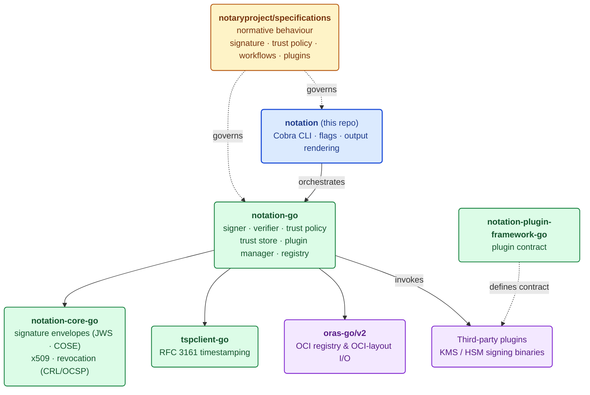
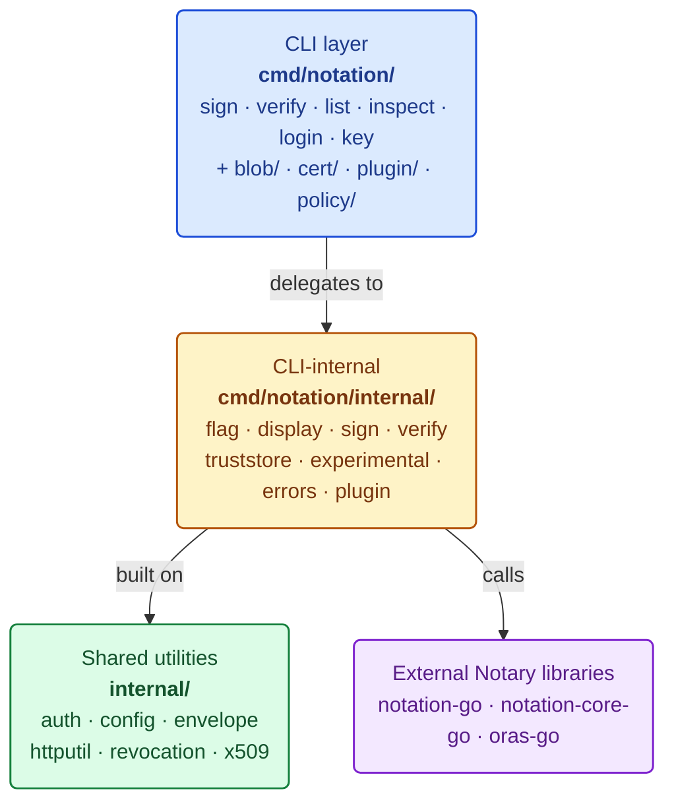
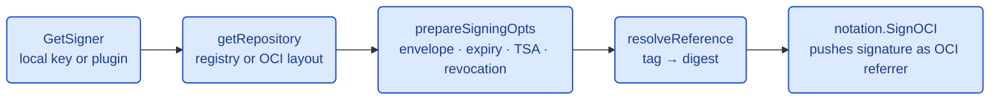
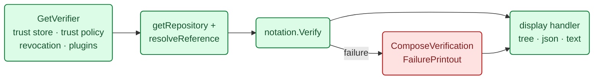
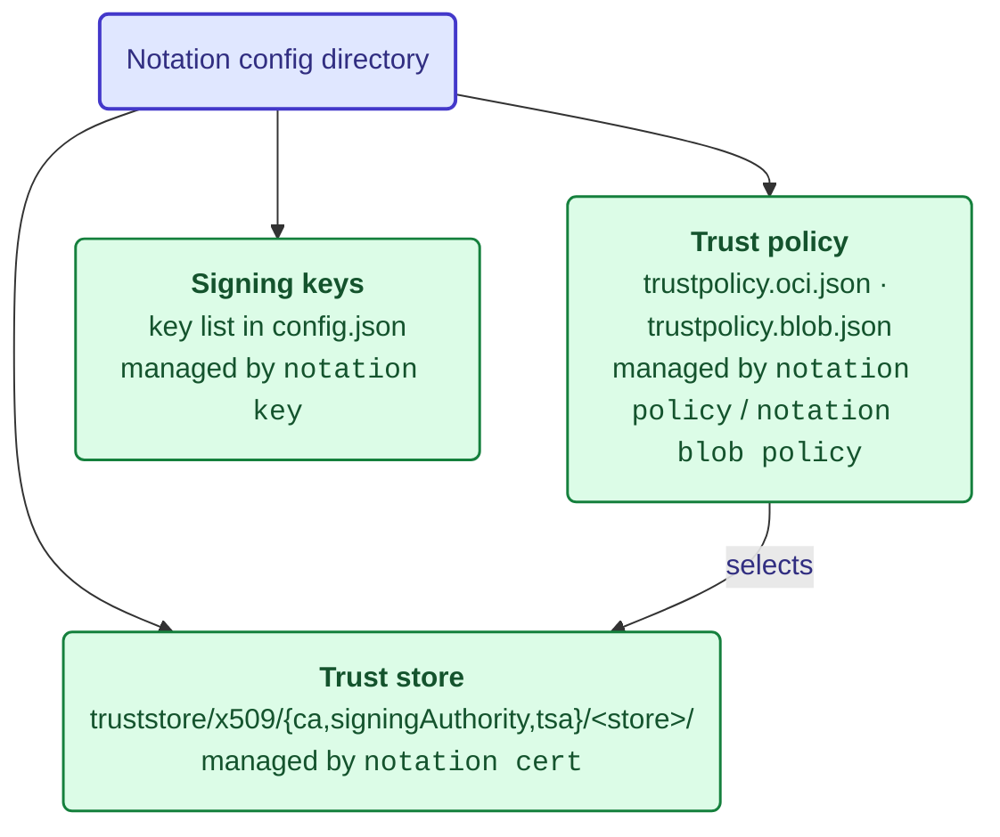
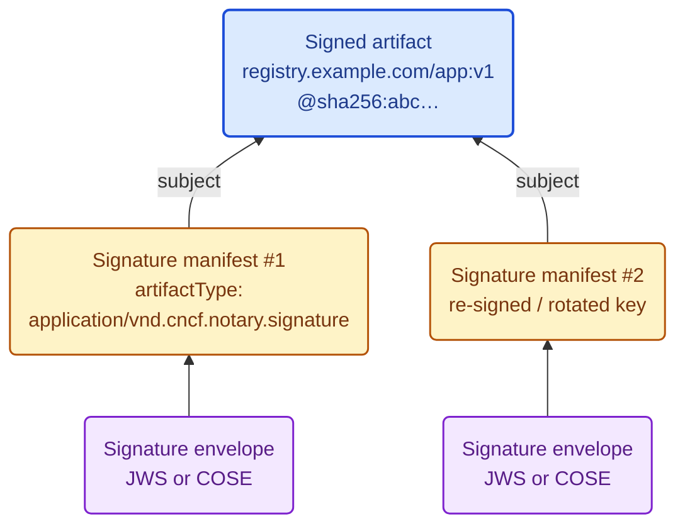
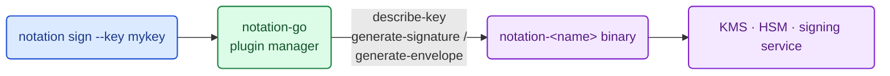
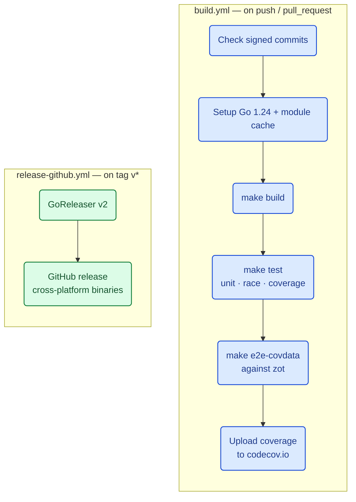

# Notation Architecture

`notation` is the reference CLI of the [Notary Project](https://notaryproject.dev), a CNCF incubating project providing a cross-industry standard for securing software supply chains. It signs and verifies OCI artifacts and arbitrary blobs, storing OCI signatures alongside the artifact they sign so they remain portable across any OCI-compliant registry.

> **The Notary Project specifications are the source of truth.** This document describes how *this CLI* is put together and where it delegates to the shared libraries. It is a map for contributors, not a restatement of the specs. For normative behaviour always refer to [notaryproject/specifications](https://github.com/notaryproject/specifications).

- **Module:** `github.com/notaryproject/notation/v2` (Go `>= 1.24`)
- **Entry point:** [`cmd/notation/main.go`](cmd/notation/main.go) — `run()` assembles the root [Cobra](https://github.com/spf13/cobra) command and registers every subcommand
- **Package detail:** run `go doc ./...` or browse [pkg.go.dev](https://pkg.go.dev/github.com/notaryproject/notation/v2); this document deliberately stays architectural so it does not drift from the code

## Table of Contents

- [Where Notation Sits in the Notary Project](#where-notation-sits-in-the-notary-project)
- [Specification Map](#specification-map)
- [Design Philosophy](#design-philosophy)
- [High-Level Architecture](#high-level-architecture)
- [Core Workflows](#core-workflows)
- [Trust Model](#trust-model)
- [Signature Storage in OCI Registries](#signature-storage-in-oci-registries)
- [Plugin Extensibility](#plugin-extensibility)
- [Developer Workflow](#developer-workflow)
- [User-Facing CLI Workflows](#user-facing-cli-workflows)

## Where Notation Sits in the Notary Project

The CLI is intentionally thin. Signing and verification algorithms, envelope formats, trust evaluation and revocation all live in shared libraries that other tools reuse.



| Dependency | Version in [`go.mod`](go.mod) | Role |
|---|---|---|
| [`notation-go`](https://github.com/notaryproject/notation-go) | `v1.2.0-beta.1.0.20250512015818-2bc67e7695ef` | Signing/verification engine, trust policy & trust store evaluation, plugin manager, registry glue |
| [`notation-core-go`](https://github.com/notaryproject/notation-core-go) | `v1.3.0` | Signature envelope generation/parsing (JWS, COSE), certificate chain validation, CRL/OCSP revocation |
| [`notation-plugin-framework-go`](https://github.com/notaryproject/notation-plugin-framework-go) | `v1.0.0` | Contract shared with out-of-process plugin binaries |
| [`tspclient-go`](https://github.com/notaryproject/tspclient-go) | `v1.0.1-0.20250306063739-4f55b14d9f01` | RFC 3161 Time-Stamp Protocol client |
| [`oras-go/v2`](https://oras.land) | `v2.6.0` | OCI registry client, registry auth, OCI image layout I/O |

> Two dependencies are pinned to untagged commits (`notation-go`, `tspclient-go`) rather than released tags, so this tree tracks pre-release library work.

## Specification Map

Each Notary Project specification maps onto concrete parts of this CLI:

| Specification | What it governs here |
|---|---|
| [signature-specification](https://github.com/notaryproject/specifications/blob/main/specs/signature-specification.md) | Signature payload, OCI signature manifest shape, blob signature file naming, required algorithms |
| [signature-envelope-jws](https://github.com/notaryproject/specifications/blob/main/specs/signature-envelope-jws.md) · [signature-envelope-cose](https://github.com/notaryproject/specifications/blob/main/specs/signature-envelope-cose.md) | The two envelope formats selectable via `--signature-format` |
| [trust-store-trust-policy](https://github.com/notaryproject/specifications/blob/main/specs/trust-store-trust-policy.md) | `notation cert *` (trust store) and `notation policy` / `notation blob policy` (trust policy), plus revocation evaluation |
| [signing-and-verification-workflow](https://github.com/notaryproject/specifications/blob/main/specs/signing-and-verification-workflow.md) | The four workflows exposed as `sign`, `verify`, `blob sign`, `blob verify` |
| [signing-scheme](https://github.com/notaryproject/specifications/blob/main/specs/signing-scheme.md) | `notary.x509` vs `notary.x509.signingAuthority` — which trust store type is consulted and how authentic signing time is established |
| [plugin-extensibility](https://github.com/notaryproject/specifications/blob/main/specs/plugin-extensibility.md) | `notation plugin *`, plugin discovery and the signing/verification plugin contracts |

This repo additionally carries **CLI-level** (non-normative) documentation under [`specs/`](specs/): [`notation-cli.md`](specs/notation-cli.md), [`error-handling-guideline.md`](specs/error-handling-guideline.md), [`registry-auth.md`](specs/registry-auth.md), per-command references in [`specs/cmd/`](specs/cmd/), and design proposals in [`specs/proposals/`](specs/proposals/).

## Design Philosophy

1. **Thin CLI layer.** Command files in `cmd/notation/` parse flags and orchestrate. Cryptographic work lives in `notation-go` / `notation-core-go`, keeping the CLI auditable and the libraries reusable.
2. **Centralized registry plumbing.** All registry, auth and OCI-layout access flows through [`registry.go`](cmd/notation/registry.go) (`getRepository`), so transport, credentials and referrers-fallback logic live in one place.
3. **Two `internal/` trees, two concerns.** `cmd/notation/internal/` holds CLI *presentation* concerns; `internal/` holds reusable lower-level utilities.
4. **Pluggable by design.** Signing keys, verification and revocation are all pluggable via the plugin framework and JSON trust policies.

## High-Level Architecture



## Core Workflows

### Signing (`runSign`, [`cmd/notation/sign.go`](cmd/notation/sign.go))



Signing always resolves a tag to an immutable digest first, so a signature is bound to specific content rather than a movable tag.

### Verification (`runVerify`, [`cmd/notation/verify.go`](cmd/notation/verify.go))



Blob commands mirror both flows using `notation.BlobSigner` / `BlobVerifier` against local files instead of a registry.

## Trust Model

> Trust store layout and trust policy semantics are defined normatively in [trust-store-trust-policy](https://github.com/notaryproject/specifications/blob/main/specs/trust-store-trust-policy.md). The summary below is a practical orientation to the on-disk artifacts this CLI manages.

Verification is governed by three artifacts under the Notation config directory (overridable with `NOTATION_CONFIG`):



- **Trust store** holds X.509 roots under three identity types: `ca`, `signingAuthority` and `tsa`. The `tsa` store is what makes RFC 3161 timestamp verification meaningful.
- **Trust policy** maps registry scopes (or blob policy names) to trust stores, verification levels and trusted identities.
- **Signing scheme** (`notary.x509` vs `notary.x509.signingAuthority`) determines which trust store type is consulted and how authentic signing time is established.

Revocation (CRL/OCSP, with an on-disk CRL cache in [`internal/revocation/crl`](internal/revocation/crl)) and RFC 3161 timestamping layer on top of both signing and verification.

## Signature Storage in OCI Registries

Signatures are stored as OCI **referrers** of the artifact they sign — discoverable via the [Referrers API](https://github.com/opencontainers/distribution-spec/blob/v1.1.0/spec.md#listing-referrers), with a [referrers tag schema](https://github.com/opencontainers/distribution-spec/blob/v1.1.0/spec.md#referrers-tag-schema) fallback for registries that do not implement it.



An artifact can carry multiple signatures. `notation list` enumerates them and `notation inspect` decodes each envelope. Because signatures live beside the artifact rather than in a separate database, they travel with the artifact when it is copied between registries.

## Plugin Extensibility

Plugins are standalone executables invoked by `notation-go` over the contract defined in [plugin-extensibility](https://github.com/notaryproject/specifications/blob/main/specs/plugin-extensibility.md), letting keys stay in a KMS/HSM and never touch the CLI process.



`notation plugin install/list/uninstall` manage the plugin lifecycle; [`cmd/notation/internal/plugin`](cmd/notation/internal/plugin) handles install sources (file vs URL) and download limits.

## Developer Workflow

Build tooling is driven by the [`Makefile`](Makefile):

| Command | Description |
|---------|-------------|
| `make build` | Builds `bin/notation` with version info injected via `-ldflags` |
| `make install` | Builds and copies `notation` to `~/bin/` |
| `make test` | Runs unit tests with race detector and coverage (`coverage.txt`) |
| `make e2e` | Builds the CLI and runs the Ginkgo e2e suite against a `zot` registry |
| `make e2e-covdata` | Runs e2e with binary coverage instrumentation |
| `make download` / `make vendor` | Downloads / vendors Go module dependencies |
| `make check-line-endings` / `fix-line-endings` | Enforces LF line endings on `.go` files |

Version metadata (`Version`, `BuildMetadata`, `GitCommit`) lives in [`internal/version`](internal/version) and is injected at link time — see the `LDFLAGS` block in the Makefile.

### CI/CD Pipeline ([`.github/workflows/`](.github/workflows))



Additional workflows: `codeql.yml` (SAST), `scorecard.yml` (OpenSSF), `license-checker.yml`, `stale.yml`, `add-to-project.yml`. Dependencies are kept current by `dependabot.yml`. **All commits must be signed.**

## User-Facing CLI Workflows

### Sign and verify an image in a registry

```sh
# 1. Authenticate to the registry
notation login registry.example.com

# 2. Generate a test key + certificate (production: use a plugin/KMS key)
notation cert generate-test --default "example.com"

# 3. Sign the artifact — the signature is pushed as an OCI referrer
notation sign registry.example.com/app:v1

# 4. Configure a trust policy, then verify
notation policy import ./trustpolicy.json
notation verify registry.example.com/app:v1

# 5. Enumerate and decode signatures
notation list    registry.example.com/app:v1
notation inspect registry.example.com/app:v1
```

### Detached blob signing

```sh
notation blob policy import ./trustpolicy.blob.json
notation blob sign   ./artifact.tar.gz            # emits a detached .sig
notation blob verify --signature artifact.tar.gz.sig ./artifact.tar.gz
```

### Plugin / KMS-backed signing

```sh
notation plugin install --file ./notation-myplugin.tar.gz
notation key add --plugin myplugin --id <key-id> mykey
notation sign --key mykey registry.example.com/app:v1
```

---

*This document reflects the repository state at the time of writing. When command wiring in [`cmd/notation/main.go`](cmd/notation/main.go) or the high-level structure changes, please update the corresponding sections.*
